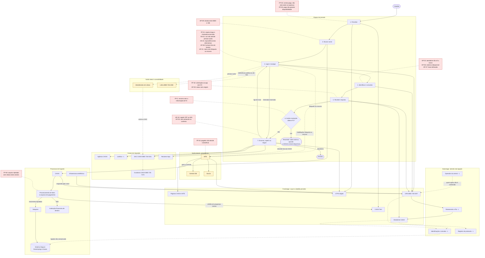

# Diagrama AS-IS: pagamento do Seguro-Desemprego não localizado

Complementa `C_blueprint_asis.md`, onde estão as descrições, categorias e fontes dos fail points.

**Como ler:** seta cheia é o fluxo da jornada ou uma interação; seta tracejada é ligação não comprovada, hipótese ou associação de fail point. Vermelho marca fail points; amarelo, saídas laterais.

## Ressalvas

- **L** indica lacuna: elemento não comprovado em fonte pública.
- Os relatos mostram que o problema ocorre, não que é o mais frequente.
- A ligação entre a consulta da chamada e as bases não está comprovada.
- Nenhuma transferência técnica entre CAIXA e MTE está comprovada: as setas de saída lateral indicam mudança de canal.
- A CTPS Digital aparece como tela consultada antes da ligação e como canal de migração.
